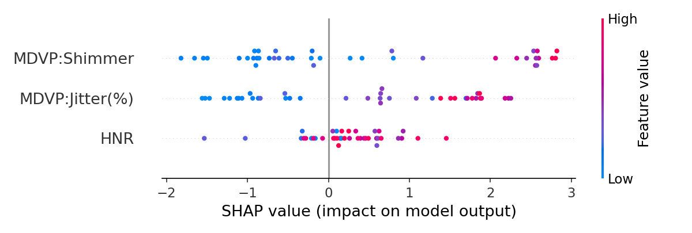

# NeuroEcho

NeuroEcho is a voice-first screening tool for early signs of neurological decline. A user records a short voice sample in the browser, the backend extracts speech biomarkers (jitter, shimmer, harmonic-to-noise ratio, pause patterns), and a machine learning model returns a **Green / Yellow / Red** risk band with a plain-language explanation.

> NeuroEcho is a screening and triage aid, not a medical diagnosis. Final assessment should always be made by a qualified clinician.

## Why it matters
- Voice changes can appear early in Parkinson's-related conditions, stroke and cognitive decline
- Needs only a microphone: a 90-second reading task on a low-cost phone or laptop
- Aimed at low-resource settings where specialist access is limited

## Features
- **Browser recording client**: records mono PCM audio with the Web Audio API, encodes WAV in the page and shows the result as a risk ring with the key biomarkers
- **Biomarker extraction**: jitter, shimmer, HNR and pitch range via Praat (Parselmouth), plus pause ratio and articulation rate via librosa
- **Explainable model**: an XGBoost classifier on three gender-neutral voice-quality features, with a SHAP summary plot
- **Optional audio CNN**: a mel-spectrogram CNN that joins the ensemble automatically when a trained `cnn_model.pt` is present
- **Consumer-microphone calibration**: corrects for the gap between clinical-booth recordings (training data) and laptop/phone microphones
- **FastAPI service** with health check, upload validation, size limits and Swagger docs, plus a Docker setup

## Architecture

```
 Browser (web/)                FastAPI (backend/)                    ML package (ml/)
┌──────────────┐  WAV upload  ┌────────────────────┐   predict()   ┌─────────────────────────┐
│ record 90 s  │─────────────▶│ POST /predict      │──────────────▶│ feature_extraction.py   │
│ encode WAV   │              │ validate + temp    │               │   Praat + librosa       │
│ show result  │◀─────────────│ file, run in pool  │◀──────────────│ ensemble.py             │
└──────────────┘  JSON result └────────────────────┘  band + msg   │   biomarker model (+CNN)│
                                                                   └─────────────────────────┘
```

Uploads are analysed from a temporary file that is deleted immediately; recordings are never stored.

## Tech stack
Python 3.11, FastAPI, Uvicorn, Parselmouth (Praat), librosa, XGBoost, scikit-learn, SHAP, PyTorch, vanilla JavaScript front end, Docker Compose.

## Project structure
| Path | Purpose |
| --- | --- |
| [web](web) | Static front end served by the API |
| [backend](backend) | FastAPI app (`main.py`), schemas, config and API tests |
| [ml](ml) | Feature extraction, training scripts, ensemble logic, ML tests |
| [ml/models](ml/models) | Trained biomarker model and SHAP plot |
| [ml/data/raw](ml/data/raw) | UCI Parkinson's dataset |
| [neuroecho_prototype.py](neuroecho_prototype.py) | Standalone rule-based demo for a single WAV file |

## Quick start

### Run locally
```bash
git clone https://github.com/Ryzuuuu/NeuroEcho.git
cd NeuroEcho
python -m venv .venv
source .venv/bin/activate        # Windows: .venv\Scripts\activate
pip install -r requirements.txt

cd backend
uvicorn main:app --reload
```
Open http://127.0.0.1:8000, allow microphone access and press **Start 90-Second Test**. Interactive API docs are at http://127.0.0.1:8000/docs.

The repository includes the small trained biomarker model (`ml/models/biomarker_model.pkl`), so it works straight after cloning. Retrain it any time (see [Model training](#model-training)).

### Run with Docker
```bash
docker compose up --build
```
The app is served at http://localhost:8000. The image uses the CPU-only PyTorch build.

### Run the tests
```bash
pip install -r requirements-dev.txt
pytest
```
The API tests mock inference and need no ML libraries. The end-to-end pipeline test in `ml/tests` is skipped automatically if the audio/ML dependencies or the trained model are missing.

### Try the analysis without the web app
```bash
python neuroecho_prototype.py path/to/voice.wav
```

## API

| Method | Path | Description |
| --- | --- | --- |
| GET | `/health` | Service health check |
| POST | `/predict` | Multipart upload (`file`: `.wav`, `.flac` or `.mp3`, up to 25 MB). Returns probability, band, message and biomarkers |

Example response:
```json
{
  "probability": 0.127,
  "band": "GREEN",
  "message": "Your speech biomarkers fall within the normal healthy range. ...",
  "biomarkers": {
    "fo_hz": 150.0, "fhi_hz": 150.2, "flo_hz": 149.8,
    "jitter_pct": 0.11, "shimmer_pct": 0.9, "hnr_db": 26.5,
    "pause_ratio": 0.0, "articulation_rate": 0.2
  }
}
```

Errors: `400` unsupported or empty file, `413` file too large, `422` audio could not be analysed, `503` model not available.

## Model training
```bash
pip install -r ml/requirements.txt
python ml/src/train_biomarker.py     # explainable model + SHAP plot
python ml/src/train_cnn.py           # optional audio CNN (needs your own WAV data)
```
The biomarker model trains on `ml/data/raw/parkinsons.data` using jitter, shimmer and HNR only. Absolute pitch is excluded on purpose because it is strongly gender-biased in this dataset. Set `MODEL_DIR` to write or load models from another directory.

### Results (UCI Parkinson's, 195 recordings)
| Metric | Value |
| --- | --- |
| 5-fold CV ROC-AUC | 0.78 ± 0.08 |
| Held-out test ROC-AUC | 0.78 |

SHAP feature importance for the biomarker model:



## Limitations
- The training set is small (195 sustained-vowel recordings from 31 people) and recorded in a sound booth, while the app records free reading on consumer microphones. A heuristic calibration bridges the gap but is not clinically validated.
- The CNN branch needs labelled audio that is not included, so by default the biomarker model alone produces the result.
- Results are probabilities from a screening model and must not be used for diagnosis.

## Data
The UCI Parkinson's dataset is by Little et al., *Suitability of dysphonia measurements for telemonitoring of Parkinson's disease*, IEEE Transactions on Biomedical Engineering, 2009, released under CC BY 4.0. The project is designed to extend to mPower and DementiaBank / Pitt Corpus.

## License
Released under the [MIT License](LICENSE).
